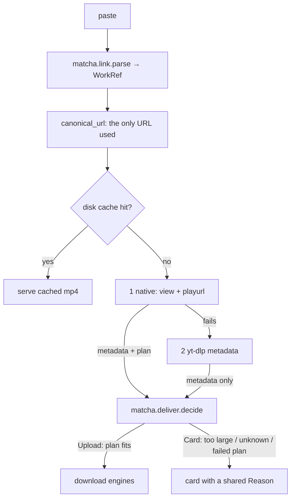
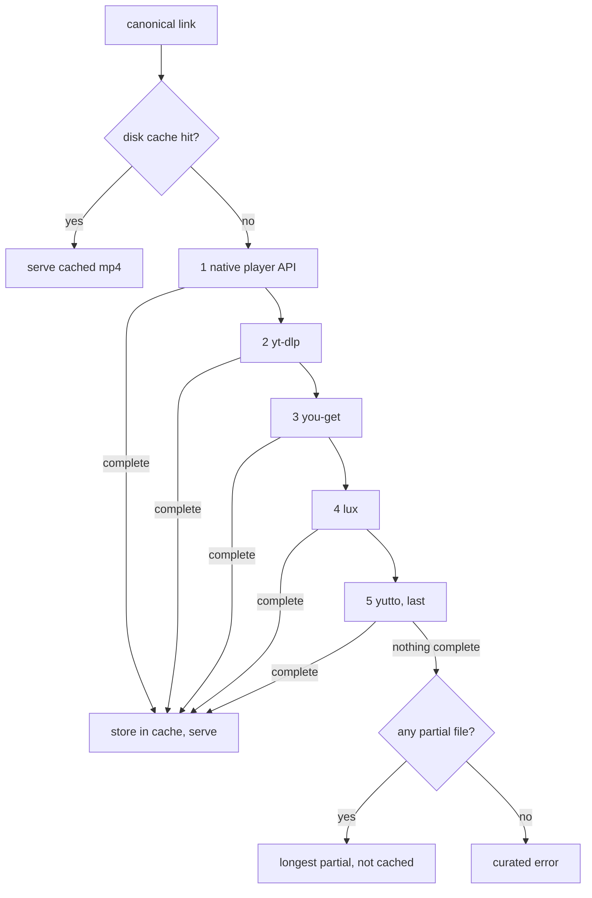
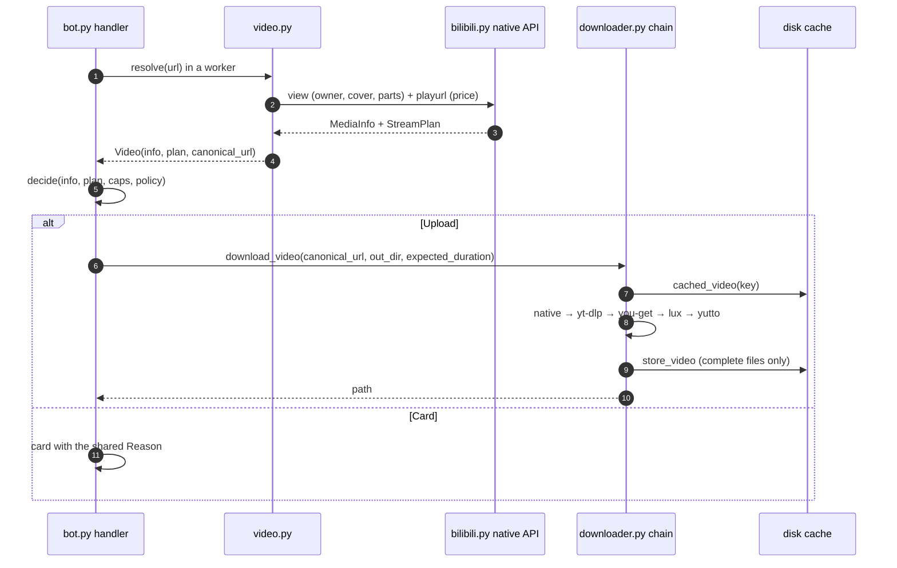

# Bilibili download chain

Bilibili links (`bilibili.com`, `b23.tv`) have their own chain. YouTube and every other
site keep the generic path (yt-dlp `pass 1` → `pass 2` → you-get → lux) and never reach
the Bilibili engines.

The shared parts of this pipeline live in [`matcha`](../matcha), a pure library that
daphne and suzuran both consume. matcha owns the grammar (`WorkRef`), the single
`canonical_url`, the request descriptions (`view`, `playurl`, `finger/spi`,
`GenWebTicket`, b23 expansion), the payload parsers, the error vocabulary (`Reason`) and
the upload-or-card rule (`matcha.deliver.decide`). Daphne owns everything that needs a
socket, a clock or a disk: performing the requests, the visitor session, ffmpeg and the
mp4 cache.

## Link intake

Every pasted link becomes a `WorkRef` through `matcha.link.parse`, and
`matcha.link.canonical_url` is the only URL daphne prints, sends to a downloader, or
stores in a card. `?p=N` survives; tracking parameters (`spm_id_from`, `vd_source`,
`share_source`, …) do not. A `b23.tv` share link is opaque, so it keeps a tracking-free
form at intake and is expanded (one redirect hop, checked to land on `bilibili.com`) before
any API call.

## Metadata and price, then delivery

### Metadata

| Order | Engine | What it does | Typical failure |
| --- | --- | --- | --- |
| 1 | Native `x/web-interface/view` | Title, owner, cover, total duration, every part and its duration, with the visitor cookies attached. Parsed by `matcha.platforms.bilibili.parse_view`. | HTTP 412 or code `-412` risk control, retried with backoff and one fresh visitor session; platform codes such as `-404` end it at once. |
| 2 | yt-dlp `--dump-json` | Reads title, uploader, duration and size; retried once with the site's headers. | Bilibili extractor broken upstream. |

`view` answers a request that carries the visitor session (the `finger/spi` cookies plus a
`bili_ticket`); it is the cookieless request that gets 412. When both engines fail the bot
keeps the message and says why, using the shared `Reason` for the failure
(`not_found`, `premium_only`, `rate_limited`, …) rather than prose invented at the call
site.

### Price

The native engine also calls `x/player/playurl` with `fnval=4048` for the selected part's
`cid`, and `matcha.platforms.bilibili.parse_playurl` prices the download from the chosen
streams' bandwidth and the part's duration. So the size is known before any byte moves.
A plan that cannot be priced is not an error: `plan=None` becomes a card, not a failure.

### Delivery

`matcha.deliver.decide` receives daphne's `Policy(auto_preview=True)` and
`Capabilities(max_upload_bytes=video_upload_limit_mb, preview_allowed=<RBAC>)`:

- a priced video that fits the limit is downloaded and uploaded, like YouTube;
- over the limit, unknown size, no plan, or no preview permission keeps the card, whose
  heading comes from the shared `Reason`.

The card keeps the resolved video, so pressing **Download video** does not look the link
up again. The button cache is bounded to 500 entries.

## Download engines

| Order | Engine | What it does | Typical failure |
| --- | --- | --- | --- |
| 0 | Disk cache | Serves a finished mp4 for 6 hours (2 GiB cap, oldest evicted), keyed by `matcha.link.cache_key` (platform, work id and part). Only files that passed the duration check are stored. | None; a miss falls through. |
| 1 | Native player API (`bilibili.py`) | Re-reads `view` and `playurl`, downloads the chosen DASH video and audio tracks, and muxes them with ffmpeg without re-encoding. Anonymous, so quality is capped at 480p. | HTTP 412 or code `-412` risk control. Retried with backoff, once with a fresh visitor session. |
| 2 | yt-dlp (`uvx yt-dlp`) | One pass with the site's headers. | Bilibili extractor broken upstream (`Unable to extract initial state`). |
| 3 | you-get (`uvx you-get`) | Writes its own file into the engine folder. | Varies by extractor. |
| 4 | lux (image binary) | Writes its own file into the engine folder. | Varies by extractor. |
| 5 | yutto (`uvx yutto`), **last** | Bilibili-specific downloader with its own API client. Its exit code is ignored; the output file decides. | Anonymous requests get the same risk control. |

## Sequence

## Decision rules

- **Complete** means the probed duration covers at least 95% of the expected duration from
  metadata. Without an expected duration, a file counts as complete. When an expected
  duration is known but probing fails, the file is not verified complete.
- Only complete files are cached, so a truncated download is never served again.
- If no engine is complete, the longest partial file is returned and marked as partial in
  the logs. It is never cached.
- A 900-second budget stops new engines from starting, so one link cannot hold a download
  slot for the sum of every engine's timeout. Each engine also has its own timeout.
- Engine errors are logged with a reason (host only, never the full link). The chat
  message is curated: a rate-limit message when risk control blocked every attempt, and a
  shared `Reason` otherwise. Raw tool output never reaches the chat.

## Limits

- **Quality:** anonymous requests cap at 480p in native, yutto, and the other engines.
  Higher quality needs a logged-in cookie (`SESSDATA`), which is not wired in yet.
- **Risk control:** intermittent. The native engine retries with backoff and refreshes the
  visitor session once; if every attempt is refused, the chain stops at once because the
  other engines reach the same host. The result depends on the host and the moment.
- **Bangumi and paid content:** not handled natively. The native engine refuses them and
  reports `auth_required`; the chain falls through.
- **Stream limits:** each native stream must finish within 300 seconds and stay under 2
  GiB, and a stream that breaks either limit is treated as a failed host.
- **Versions:** yt-dlp, you-get, and yutto run at the latest PyPI release, refreshed at
  bot start. lux is the latest GitHub release, resolved at each image build.
- **Cache:** lives in `$TMPDIR/daphne-bilibili`. This is the only state Daphne keeps.

## Where it lives

- `src/daphne/bilibili.py`: performs matcha's request descriptions, the visitor session,
  backoff, ffmpeg muxing and the disk cache.
- `src/daphne/video.py`: link intake, the metadata chain (native then yt-dlp), the price,
  and daphne's one `Policy` value.
- `src/daphne/downloader.py`: `_download_bilibili_video`, `_run_bilibili_chain`, the
  per-engine helpers, and the generic yt-dlp → you-get → lux path.
- `Dockerfile`: installs lux from its latest release.
- `tests/test_bilibili.py`, `tests/test_video.py`, and `tests/test_downloader.py`
  (`TestBilibiliChain`).
