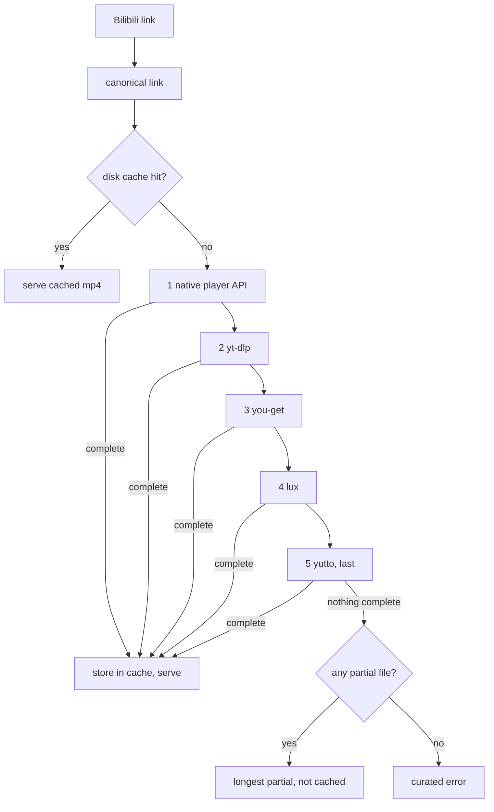
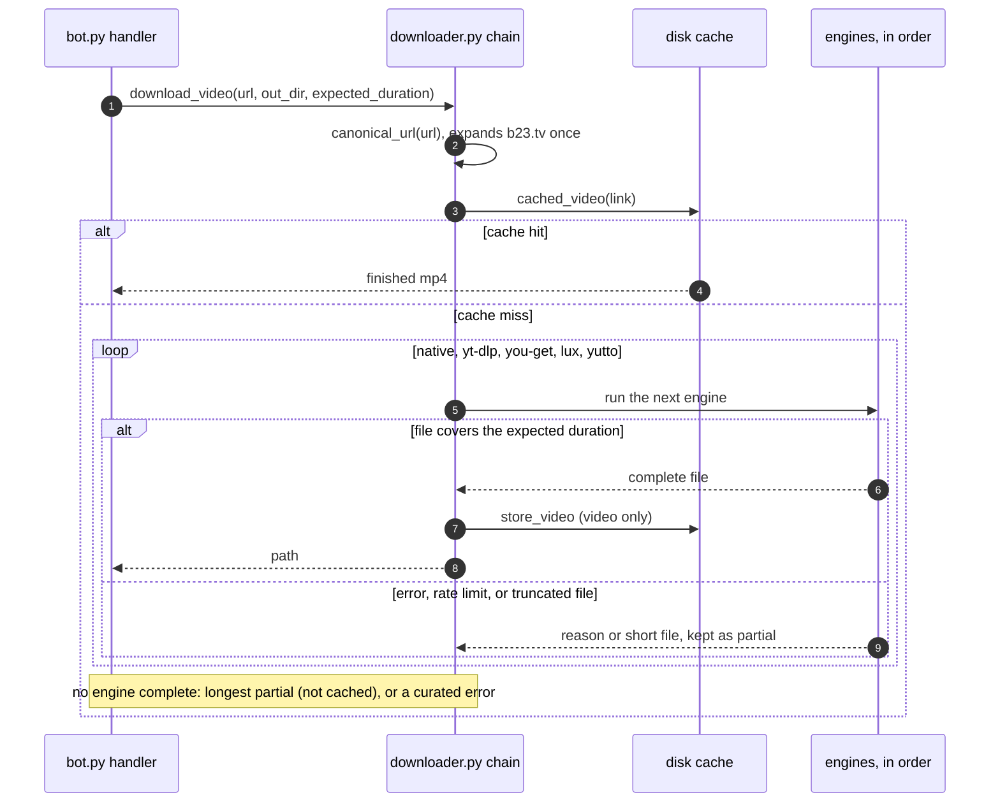

# Bilibili download chain

Bilibili links (`bilibili.com`, `b23.tv`) have their own chain. YouTube and every other
site keep the generic path (yt-dlp `pass 1` → `pass 2` → you-get → lux) and never reach
the Bilibili engines.

## Video order

## Engines

| Order | Engine | What it does | Typical failure |
| --- | --- | --- | --- |
| 0 | Disk cache | Serves a finished mp4 by `bvid` and part for 6 hours (2 GiB cap, oldest evicted). Only files that passed the duration check are stored. | None; a miss falls through. |
| 1 | Native player API (`bilibili.py`) | `pagelist` for the part's cid and duration, `playurl` with `fnval=4048` for DASH. The `view` endpoint is refused, so it is not used. Downloads the video and audio tracks and muxes them with ffmpeg, without re-encoding. Anonymous, so quality is capped at 480p. | HTTP 412 or code -412 risk control. Retried with backoff, once with a fresh visitor session. |
| 2 | yt-dlp (`uvx yt-dlp`) | One pass with the site's headers. | Bilibili extractor broken upstream (`Unable to extract initial state`). |
| 3 | you-get (`uvx you-get`) | Writes its own file into the engine folder. | Varies by extractor. |
| 4 | lux (image binary) | Writes its own file into the engine folder. | Varies by extractor. |
| 5 | yutto (`uvx yutto`), **last** | Bilibili-specific downloader with its own API client. Its exit code is ignored; the output file decides. | Anonymous requests get the same risk control. |

Metadata comes from pagelist: the part's name as the title, the duration, and the link. The uploader is empty and no size is known, because the view endpoint is refused. So a Bilibili paste always shows a card. yt-dlp `--dump-json` runs only if the native call fails.

## Sequence

## Decision rules

- **Complete** means the probed duration covers at least 95% of the expected duration
  from metadata. Without an expected duration, a file counts as complete.
- Only complete files are cached, so a truncated download is never served again.
- If no engine is complete, the longest partial file is returned and marked as partial in
  the logs. It is never cached.
- A 900-second budget stops new engines from starting, so one link cannot hold a download
  slot for the sum of every engine's timeout. Each engine also has its own timeout.
- Engine errors are logged with a reason (host only, never the full link). The chat
  message is curated: a rate-limit message when risk control blocked every attempt, and a
  generic failure otherwise. Raw tool output never reaches the chat.

## Limits

- **Quality:** anonymous requests cap at 480p in native, yutto, and the other engines.
  Higher quality needs a logged-in cookie (`SESSDATA`), which is not wired in yet.
- **Risk control:** on 2026-10-29 the test host got `-412 request was banned` from the `view`
  endpoint in every variant: plain, with visitor cookies, and with a `bili_ticket`. The
  `pagelist` and `playurl` endpoints answered with code 0, both unsigned and wbi-signed,
  once the visitor cookies and ticket were sent. yutto failed on the same host at its first
  call. The result comes from one host and one moment; it is not
  a guarantee.
- **Bangumi and paid content:** not handled natively. The native engine refuses them, and
  the chain falls through.
- **Stream limits:** each native stream must finish within 300 seconds and stay under 2 GiB, and a stream that breaks either limit is treated as a failed host.
- **Versions:** yt-dlp, you-get, and yutto run at the latest PyPI release, refreshed at
  bot start. lux is the latest GitHub release, resolved at each image build.
- **Cache:** lives in `$TMPDIR/daphne-bilibili`. This is the only state Daphne keeps.

## Where it lives

- `src/daphne/bilibili.py`: native API client, visitor session, backoff, disk cache.
- `src/daphne/downloader.py`: `_download_bilibili_video`,
  `_run_bilibili_chain`, the per-engine helpers, and the generic yt-dlp → you-get → lux path.
- `Dockerfile`: installs lux from its latest release.
- `tests/test_downloader.py` (`TestBilibiliChain`) and `tests/test_bilibili.py`.
