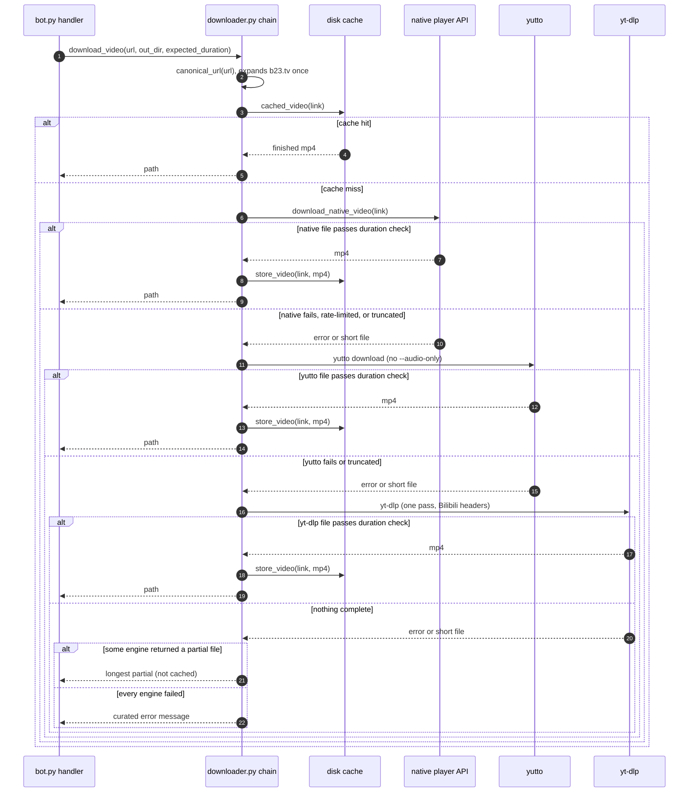

# Bilibili download chain

Bilibili links (`bilibili.com`, `b23.tv`) have their own chain. YouTube and every other
site keep the yt-dlp path (`pass 1` → `pass 2`) and never reach these engines.

## Engines

| Order | Engine | What it does | Typical failure |
| --- | --- | --- | --- |
| 0 | Disk cache | Serves a finished mp4 by `bvid` + part, for 6 hours (2 GiB cap, oldest evicted). Only files that passed the duration check are stored. | None; a miss falls through. |
| 1 | Native player API (`bilibili.py`) | `view` for metadata, `playurl` with `fnval=4048` for DASH. Downloads the video and audio tracks and muxes them with ffmpeg (no re-encode). Anonymous, so quality is capped at 480p. | HTTP 412 / code -412 risk control (retried with backoff, once with a fresh visitor session). |
| 2 | yutto (`uvx yutto`) | Bilibili-specific downloader with its own API client. Runs `--audio-only` for audio. Exit code is ignored; the output file decides. | Anonymous requests get the same risk control; no retry of its own. |
| 3 | yt-dlp (`uvx yt-dlp`) | Last resort. The Bilibili extractor is broken upstream right now (`Unable to extract initial state`). | Usually fails on the extractor. |

Metadata uses engine 1 first and yt-dlp `--dump-json` only if the native call fails.
Audio uses the same order: native audio track, yutto `--audio-only`, yt-dlp audio extract.

## Sequence

## Decision rules

- **Complete** means the probed duration covers at least 95% of the expected duration
  from metadata. Without an expected duration, a file counts as complete.
- Only complete files are cached, so a truncated download is never served again.
- If no engine is complete, the longest partial file is returned and marked as partial in
  the logs. It is never cached.
- A 900-second budget stops new engines from starting, so one link cannot hold a download
  slot for the sum of every engine's timeout (each engine also has its own timeout).
- Engine errors are logged with a reason (host only, never the full link). The chat
  message is curated: a rate-limit message when risk control blocked every attempt, and a
  generic failure otherwise. Raw tool output never reaches the chat.

## Limits

- **Quality:** anonymous requests cap at 480p in both native and yutto. Higher quality
  needs a logged-in cookie (`SESSDATA`), which is not wired in yet.
- **Risk control:** Bilibili answers `-412 request was banned` per IP. On 2026-10-29 the
  test host got it from the first `view` call, with and without visitor cookies, and yutto
  failed the same way. The chain can only recover once the ban lifts.
- **Bangumi and paid content:** not handled natively. The native engine refuses them, and
  the chain falls through.
- **Cache:** lives in `$TMPDIR/daphne-bilibili`. This is the only state Daphne keeps.

## Where it lives

- `src/daphne/bilibili.py`: native API client, visitor session, backoff, disk cache.
- `src/daphne/downloader.py`: `_download_bilibili_video`, `_download_bilibili_audio`,
  `_run_bilibili_chain`, `yutto_fetch`, and the yt-dlp engines.
- `tests/test_downloader.py` (`TestBilibiliChain`) and `tests/test_bilibili.py`.
